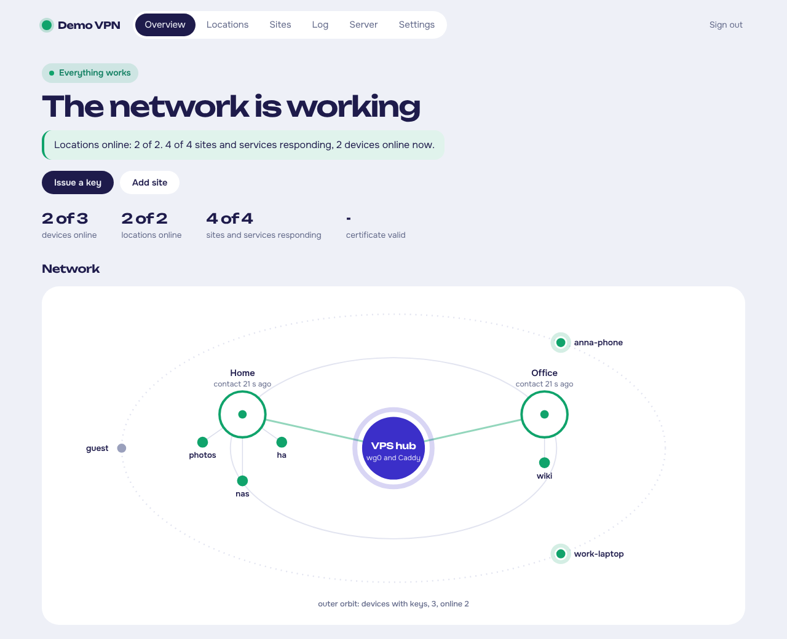
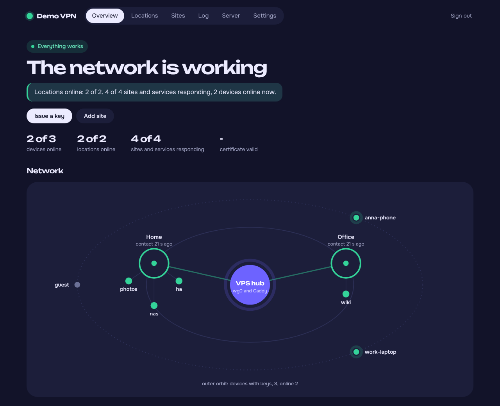
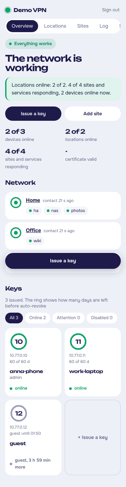
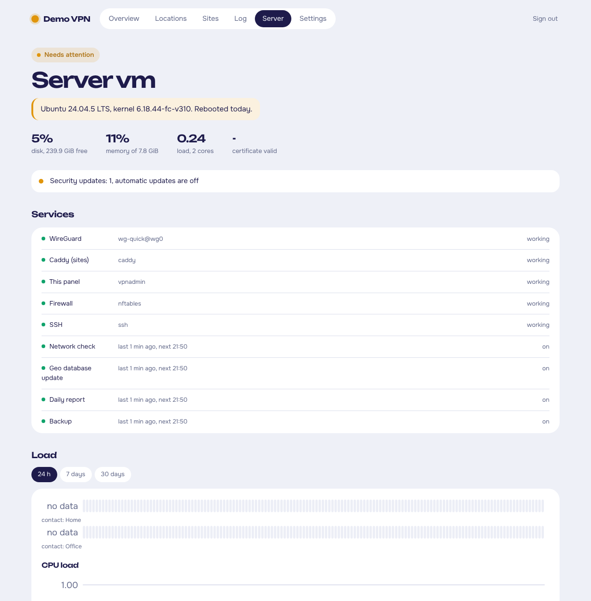

# wgctl-hub — a small, strict VPN hub for your home services

[Українською](README.uk.md)

wgctl turns a cheap VPS into a WireGuard hub that gives your phones and laptops access to **chosen** services at home or at work — a NAS, a camera, Proxmox, a router page — without opening a single port on your home network and without handing out a "full" VPN.



The project is called **wgctl-hub**; the commands on the server are `wgctl` (WireGuard control) and `vpnadmin` (the panel).

- **One key = one device, one list of sites.** A key opens only the sites you tick, nothing else: no access to the home network as a whole, to the router, or to other devices.
- **Sites by name.** `nas.example.org`, `photos.example.org` — real HTTPS certificates (Let's Encrypt via Cloudflare DNS), served by Caddy on the hub and reachable only through the tunnel.
- **No inbound ports at home.** The router (MikroTik or any WireGuard-capable router) dials out to the hub.
- **Internet traffic stays local.** Clients route only the hub's address into the tunnel; browsing does not go through the VPS.
- **Web panel and CLI.** `wgctl` (root CLI) does the work; `vpnadmin` is a small panel with password + TOTP that can only call `wgctl`.
- **Guest keys for a few hours**, auto-revoke of keys unused for 60 days, key rotation reminders.
- **SSH, RDP and other TCP services** through the hub, per key.
- **Signal notifications**: new country or provider, impossible travel, Tor, failures, daily report.
- **Visit log and charts**, VPS health (disk, memory, updates, certificate), **encrypted daily backups** (age).
- **English and Ukrainian** in the CLI, notifications and panel.

## How it works

```
 phone / laptop ──WireGuard──►  VPS hub 10.77.0.1  ◄──WireGuard──  home router 10.77.0.2
   AllowedIPs = 10.77.0.1/32     Caddy: nas.example.org            LAN 192.168.1.0/24
                                 └─ only for keys allowed ─► reverse proxy ─► 192.168.1.10:5000
```

The hub never forwards packets between interfaces (`forward` policy is `drop`). A client talks only to Caddy on `10.77.0.1`; Caddy checks the client's VPN address against the site's allow-list and proxies the request to the home network through the router's tunnel. The router accepts from the tunnel only the hub's address and only the ports you allow.

Details: [architecture and security model](docs/en/security.md).

## Requirements

- A VPS with a public IPv4 address, **Ubuntu 24.04+ or Debian 12+** (Python 3.11+), 512 MB RAM is plenty.
- A domain on **Cloudflare** (free plan) and an API token for DNS (certificates; optional public sites).
- At each location a router that speaks WireGuard (MikroTik RouterOS 7, OpenWrt, pfSense, a Linux box…).
- Optional: [signal-cli](https://github.com/AsamK/signal-cli) and a spare phone number for notifications.

## Quick start

```bash
git clone https://github.com/Hyrol7/wgctl-hub.git && cd wgctl-hub
sudo ./install.sh
```

The installer explains each step and asks before changing anything (packages, firewall, services). Then either open the panel and follow **First steps** on the overview page, or do the same from SSH:

```bash
sudo wgctl location add home --title Home --networks 192.168.1.0/24   # a router at home; prints its config
sudo wgctl site add nas http://192.168.1.10:5000                       # https://nas.example.org
sudo wgctl add my-phone --sites nas --admin --qr                       # first key, scan the QR
sudo wgctl panel on                                                    # https://vpnadmin.example.org
sudo wgctl backup init
```

Locations are your own list: a home, an office, a summer house — any router that speaks WireGuard. Each one gets a ready config for MikroTik, OpenWrt or a plain WireGuard file, from the CLI or the **Locations** page of the panel.

Full guide: [installation](docs/en/install.md) · [locations and routers](docs/en/locations.md) · [everyday use](docs/en/usage.md) · [TCP services](docs/en/tcp-services.md) · [Signal](docs/en/signal.md) · [backups](docs/en/backups.md) · [security](docs/en/security.md) · [updating](docs/en/install.md#updating)

## Screenshots

| Dark theme | Phone |
|---|---|
|  |  |



## Updating

```bash
sudo wgctl-update            # shows what changed, makes a backup, installs the latest release
sudo wgctl-update --check    # only check; the Server page and the daily report also say when a release is out
sudo wgctl-update --rollback # back to the previous version
```

To remove it: `sudo ./uninstall.sh` (keeps your keys and settings) or `sudo ./uninstall.sh --purge`.

## Language

English and Ukrainian: choose on the **Settings** page of the panel or with `sudo wgctl config --language en`. The source strings are Ukrainian; translations live in `share/i18n/<lang>.json`. To add a language, copy `en.json`, translate the values and run `python3 tools/i18n.py check` — see [CONTRIBUTING](CONTRIBUTING.md).

## Development

```bash
pip install pytest pyflakes
python3 -m pytest -q tests          # runs the CLI and the panel in a throw-away root, no root needed
python3 tools/i18n.py check
```

## License

[MIT](LICENSE). Fonts Onest and Unbounded are under the SIL Open Font License ([share/static/fonts/OFL.txt](share/static/fonts/OFL.txt)). IP geolocation by [DB-IP](https://db-ip.com) (CC BY 4.0), downloaded on your server.
