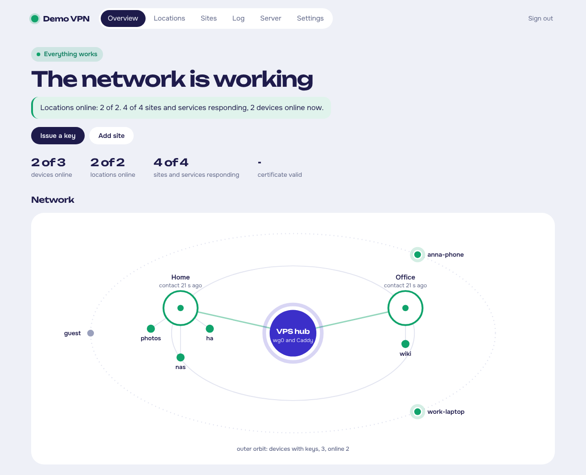
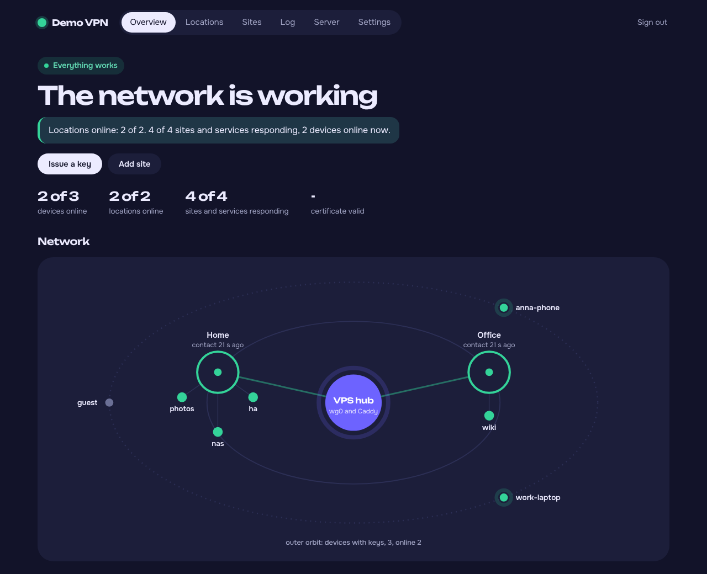
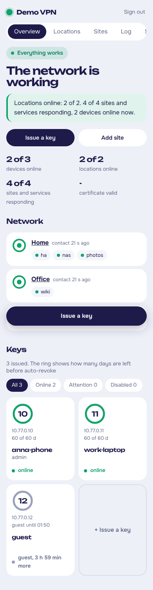
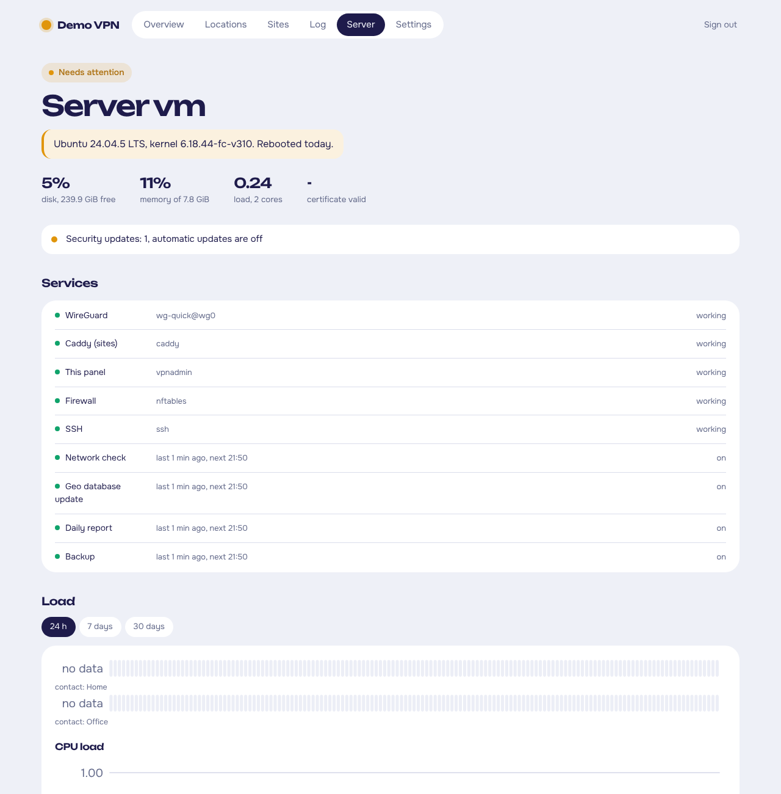

# wgctl-hub — невеликий суворий VPN-хаб для домашніх сервісів

[English](README.md)

wgctl перетворює недорогий VPS на хаб WireGuard, через який телефони й ноутбуки отримують доступ до **вибраних** сервісів удома чи на роботі — NAS, камера, Proxmox, сторінка роутера — без жодного відкритого порту в домашній мережі й без «повного» VPN.



Проєкт називається **wgctl-hub**; команди на сервері — `wgctl` (керування WireGuard) і `vpnadmin` (панель).

- **Один ключ = один пристрій і свій список сайтів.** Ключ відкриває лише позначені сайти: ні домашньої мережі загалом, ні роутера, ні інших пристроїв.
- **Сайти за іменами.** `nas.example.org`, `photos.example.org` — справжні HTTPS-сертифікати (Let's Encrypt через DNS Cloudflare), їх обслуговує Caddy на хабі, і доступні вони лише через тунель.
- **Удома не відкрито жодного порту.** Роутер (MikroTik або будь-який з WireGuard) сам підключається до хаба.
- **Інтернет-трафік лишається локальним.** Клієнт спрямовує в тунель лише адресу хаба; сайти в інтернеті відкриваються напряму, не через VPS.
- **Вебпанель і командний рядок.** `wgctl` (CLI від root) робить усю роботу; `vpnadmin` — невелика панель із паролем і TOTP, яка вміє лише викликати `wgctl`.
- **Гостьові ключі на кілька годин**, автовідкликання ключів, якими не користувались 60 днів, нагадування про зміну ключів.
- **SSH, RDP та інші TCP-сервіси** через хаб, окремо для кожного ключа.
- **Сповіщення в Signal**: нова країна чи провайдер, неможлива подорож, Tor, збої, щоденний звіт.
- **Журнал відвідувань і графіки**, стан VPS (диск, пам'ять, оновлення, сертифікат), **щоденні зашифровані резервні копії** (age).
- **Українська та англійська** в CLI, сповіщеннях і панелі.

## Як це працює

```
 телефон / ноутбук ──WireGuard──►  VPS-хаб 10.77.0.1  ◄──WireGuard──  роутер удома 10.77.0.2
   AllowedIPs = 10.77.0.1/32        Caddy: nas.example.org             LAN 192.168.1.0/24
                                    └─ лише для дозволених ключів ─► reverse proxy ─► 192.168.1.10:5000
```

Хаб ніколи не пересилає пакети між інтерфейсами (політика `forward` — `drop`). Клієнт розмовляє лише з Caddy на `10.77.0.1`; Caddy звіряє VPN-адресу клієнта зі списком дозволених для сайту і передає запит у домашню мережу через тунель роутера. Роутер приймає з тунелю лише адресу хаба і лише дозволені порти.

Детальніше: [архітектура і модель безпеки](docs/uk/security.md).

## Що потрібно

- VPS із публічною IPv4, **Ubuntu 24.04+ або Debian 12+** (Python 3.11+); 512 МБ пам'яті достатньо.
- Домен у **Cloudflare** (безкоштовний план) і API-токен для DNS (сертифікати; за бажання — публічні сайти).
- У кожній локації роутер із WireGuard (MikroTik RouterOS 7, OpenWrt, pfSense, Linux…).
- За бажання: [signal-cli](https://github.com/AsamK/signal-cli) і окремий номер телефону для сповіщень.

## Швидкий старт

```bash
git clone https://github.com/Hyrol7/wgctl-hub.git && cd wgctl-hub
sudo ./install.sh
```

Інсталятор пояснює кожен крок і питає перед будь-якою зміною (пакети, брандмауер, служби). Далі відкрийте панель і пройдіть **Перші кроки** на сторінці огляду або зробіть те саме через SSH:

```bash
sudo wgctl location add home --title Дім --networks 192.168.1.0/24    # роутер удома; покаже його конфіг
sudo wgctl site add nas http://192.168.1.10:5000                       # https://nas.example.org
sudo wgctl add my-phone --sites nas --admin --qr                       # перший ключ, відскануйте QR
sudo wgctl panel on                                                    # https://vpnadmin.example.org
sudo wgctl backup init
```

Локації — ваш власний список: дім, офіс, дача — будь-який роутер із WireGuard. Для кожної є готовий конфіг для MikroTik, OpenWrt або звичайний файл WireGuard, у CLI чи на сторінці **Локації** панелі.

Повна інструкція: [встановлення](docs/uk/install.md) · [локації й роутери](docs/uk/locations.md) · [щоденне користування](docs/uk/usage.md) · [TCP-сервіси](docs/uk/tcp-services.md) · [Signal](docs/uk/signal.md) · [резервні копії](docs/uk/backups.md) · [безпека](docs/uk/security.md) · [оновлення](docs/uk/install.md#оновлення)

## Знімки екрана

| Темна тема | Телефон |
|---|---|
|  |  |



(Знімки зроблено з англійським інтерфейсом; з `language = "uk"` усе українською.)

## Оновлення

```bash
sudo wgctl-update            # покаже зміни, зробить копію і встановить свіжий реліз
sudo wgctl-update --check    # лише перевірити; про новий реліз скажуть і сторінка «Сервер», і щоденний звіт
sudo wgctl-update --rollback # повернутись до попередньої версії
```

Видалити: `sudo ./uninstall.sh` (ключі й налаштування лишаються) або `sudo ./uninstall.sh --purge`.

## Мова

Українська та англійська: виберіть на сторінці **Налаштування** панелі або командою `sudo wgctl config --language uk`. Рядки в коді — українські; переклади лежать у `share/i18n/<мова>.json`. Щоб додати мову, скопіюйте `en.json`, перекладіть значення і запустіть `python3 tools/i18n.py check` — див. [CONTRIBUTING](CONTRIBUTING.md).

## Розробка

```bash
pip install pytest pyflakes
python3 -m pytest -q tests          # CLI і панель у тимчасовому корені, root не потрібен
python3 tools/i18n.py check
```

## Ліцензія

[MIT](LICENSE). Шрифти Onest і Unbounded — під SIL Open Font License ([share/static/fonts/OFL.txt](share/static/fonts/OFL.txt)). Геолокація IP — [DB-IP](https://db-ip.com) (CC BY 4.0), бази завантажуються на ваш сервер.
